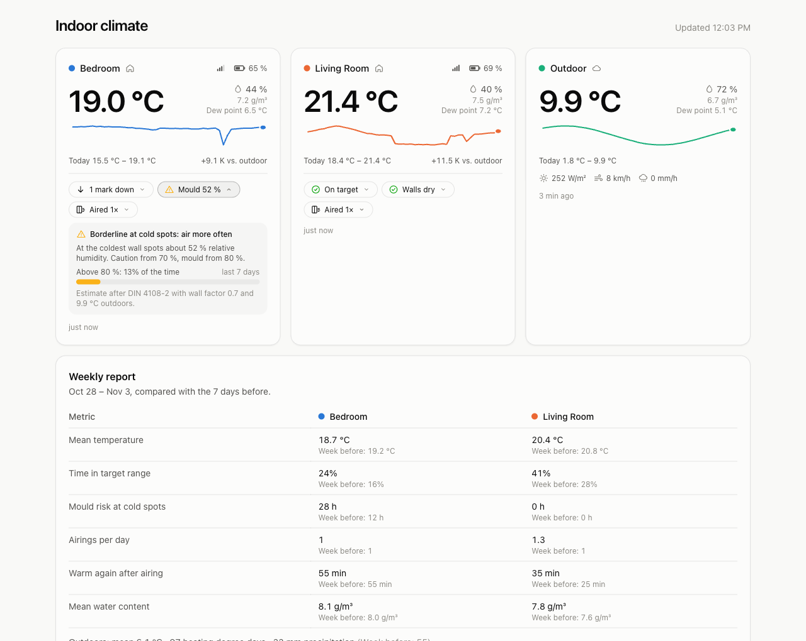
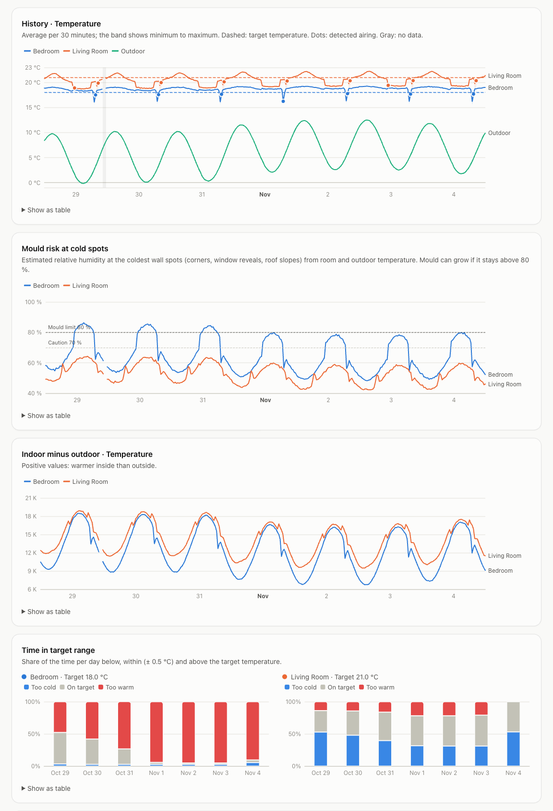
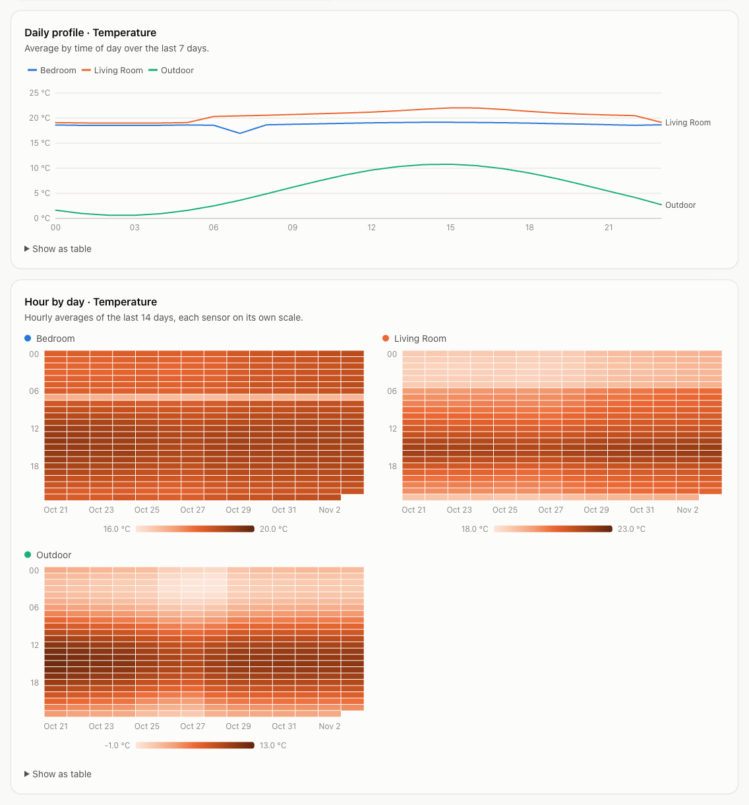
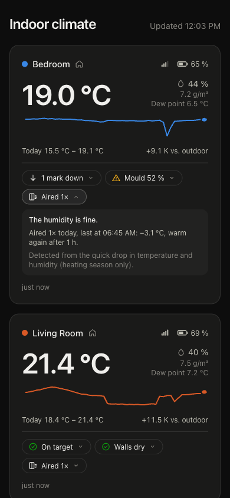

# mi-homekit-bridge

[](https://github.com/huulanka/mi-homekit-bridge/actions/workflows/ci.yml)

A tiny, single-purpose bridge that brings Bluetooth thermometers such as the
**Xiaomi Mi Temperature and Humidity Monitor 2 (LYWSD03MMC)** into **Apple Home**.
No Home Assistant, no Homebridge, no web UI: one small Python service on a
Raspberry Pi (or any Linux box with Bluetooth).

```
LYWSD03MMC ──BLE advertisements──▶ mi-homekit-bridge ──HomeKit (HAP)──▶ Home app / HomePod
```

Each sensor shows up in the Home app with temperature, humidity and battery level,
and, with outdoor data, the **mould risk as air quality**. The bridge only listens
to the advertisements the sensors broadcast anyway; it never connects to them.

Optionally it also keeps a **measurement history** in a local SQLite database,
records the **outdoor weather** for your postal code, and serves a small **web
dashboard** to explore it all over days, months and years: absolute humidity,
mould risk at cold walls, detected airing, time in the target temperature range,
heating degree days and a weekly report.



Under the hood it glues together the libraries that also power Home Assistant:
[bleak](https://github.com/hbldh/bleak) (Bluetooth),
[xiaomi-ble](https://github.com/Bluetooth-Devices/xiaomi-ble) and
[bthome-ble](https://github.com/Bluetooth-Devices/bthome-ble) (parsing and decryption),
and [HAP-python](https://github.com/ikalchev/HAP-python) (HomeKit).

## Supported sensors

| Sensor | Format | Bindkey needed |
|---|---|---|
| Xiaomi LYWSD03MMC, stock firmware | encrypted MiBeacon v4/v5 | yes, see [Bindkeys](#bindkeys-stock-firmware-only) |
| LYWSD03MMC with [pvvx custom firmware](https://github.com/pvvx/ATC_MiThermometer), or any other BTHome v2 sensor | BTHome v2 | only if you enabled BTHome encryption |

Other Xiaomi MiBeacon thermometers supported by `xiaomi-ble` will most likely work too,
but are untested.

Recent stock firmware of the LYWSD03MMC does not broadcast its battery level, only
temperature and humidity. The bridge then shows no battery in the Home app (instead
of a wrong 0 %). The pvvx firmware broadcasts it. After flashing a sensor to pvvx
with unencrypted BTHome, remove its old bindkey from `bindkeys.env`: with a key
configured, unencrypted data is ignored (downgrade protection), and the log says so.

## Requirements

- Linux with BlueZ (tested on a Raspberry Pi 3 Model B with Debian 13)
- Python 3.13
- The bridge must be in the same network as your iPhone and home hub (mDNS)

## Installation

### 1. Install the service

From a checkout on your computer (needs [uv](https://docs.astral.sh/uv/)):

```sh
scripts/deploy.sh user@your-pi
```

This installs the bridge into `/opt/mi-homekit-bridge/venv` with the hash-pinned
dependency versions from `uv.lock` and installs the systemd unit (needs `sudo` on the
host). Re-run it to upgrade. Your config and keys on the host are never touched.

### 2. Find your sensors

```sh
/opt/mi-homekit-bridge/venv/bin/mi-homekit-bridge scan
```

```
A4:C1:38:xx:xx:xx   -61 dBm  LYWSD03MMC     Xiaomi MiBeacon (encrypted, needs bindkey)
```

### 3. Configure

```sh
sudo install -m 644 config.example.toml /etc/mi-homekit-bridge/config.toml
sudoedit /etc/mi-homekit-bridge/config.toml   # names and MAC addresses
```

The config file never contains secrets, see [Secrets](#secrets-and-privacy).

### Bindkeys (stock firmware only)

Sensors on stock firmware only send measurements after they have been added to the
**Mi Home** app, and they encrypt them with a per-device *bindkey*. Fetch the keys
from your Xiaomi account:

```sh
sudo /opt/mi-homekit-bridge/venv/bin/mi-homekit-bridge fetch-keys \
    --env-file /etc/mi-homekit-bridge/bindkeys.env
```

You are asked for your Xiaomi account and password. They are only used for this
one login and are never stored. The keys end up in `bindkeys.env` (mode 600).
If Xiaomi asks for an additional verification, the command prints a link: open it,
confirm, and run the command again.

#### Accounts without a password (Sign in with Apple/Google) or captcha prompts

`fetch-keys` can only do a plain password login. If your Xiaomi account was created
with *Sign in with Apple/Google/Facebook*, or Xiaomi insists on a captcha, the login
is rejected ("Xiaomi rejected the login"). Use the QR-code login of the
[Xiaomi Cloud Tokens Extractor](https://github.com/PiotrMachowski/Xiaomi-cloud-tokens-extractor)
instead: choose `q`, scan the code with the Mi Home app and note the `BLE KEY` of each
sensor. Then store each key (the prompt is hidden, the file is created with mode 600):

```sh
sudo /opt/mi-homekit-bridge/venv/bin/mi-homekit-bridge set-key A4:C1:38:XX:XX:XX
```

The extractor also prints tokens for your other Xiaomi devices (e.g. a vacuum).
Treat them as secrets and do not paste them anywhere.

### 4. Start

```sh
sudo systemctl enable --now mi-homekit-bridge
journalctl -u mi-homekit-bridge -o cat     # shows the HomeKit setup code and a QR code
```

### 5. Add to the Home app

Home app → **+** → **Add Accessory** → scan the QR code from the log or enter the
setup code manually. The setup code is also stored in
`/var/lib/mi-homekit-bridge/setup.json` and stays the same across restarts.

## Dashboard

An optional, read-only web dashboard built into the bridge (no extra service):

- **Overview**: one card per room with temperature, relative and absolute humidity,
  dew point, battery (with its age), signal strength, today's range, the difference
  to outdoor and the last 24 hours. Three chips open the details:
  - **Target temperature** (optional, per room): whether the room is too warm or too
    cold (median of the last 3 hours, so airing does not count and a turned
    thermostat shows within hours) and which way to turn the radiator thermostat, in
    marks on the dial (one mark is roughly 1 °C). Deliberately relative: what a dial
    position means differs a lot between rooms and flats. No advice to turn down
    when it is above 15 °C outdoors.
  - **Mould risk** at the coldest wall spots, now and over the last 7 days (see
    [Humidity, mould and airing](#humidity-mould-and-airing)).
  - **Airing**: whether airing helps right now and for how long, and how often the
    room was aired today and how long it took to get warm again.
- **Weekly report**: the last 7 complete days against the week before: mean
  temperature, time in the target range, hours with mould risk, airings per day,
  warm-up time after airing, water content, heating degree days and precipitation.
- **Live status**: a banner when Bluetooth fails, the bridge is not paired with Apple
  Home, the Raspberry Pi reports under-voltage, or the dashboard has lost its
  connection (then it says how old the data is). CPU temperature and power supply
  in the footer.
- **Events**: sensor outages, Bluetooth recoveries, controller resets and
  under-voltage, kept in the database so they survive reboots. Restarts and updates
  are summarised.
- **History**: all sensors in one chart for 24 hours up to everything recorded.
  Longer ranges show averages with a min–max band, dashed target lines, dots for
  detected airing and gray bands where no data was recorded.
- **Mould risk at cold spots**: the estimated wall humidity over time with the 70 %
  and 80 % limits.
- **Indoor minus outdoor**: temperature, or the water content (g/m³) for humidity.
  Relative humidity cannot be compared between a warm room and cold outdoor air.
- **Time in target range**: per day (or month) the share of time too cold, on
  target and too warm.
- **Weather**: solar radiation, wind and precipitation as small multiples.
- **Heating degree days** (G20/15) per day or month.
- **Daily profile**, **hour × day heatmap** and, for a year, a **calendar** of daily
  means.
- Temperature, relative and absolute humidity for every chart. Every chart has a
  table view. CSV export of all data. Light and dark mode follow the system, the
  language follows the browser (English, German).

| History, mould risk, time in target | Patterns | Phone, dark mode |
|---|---|---|
|  |  |  |

*Screenshots use generated sample data (`mi-homekit-bridge demo`).*

Enable it in the config:

```toml
[web]
enabled = true          # requires [history]
host = "127.0.0.1"      # keep it on localhost ...
port = 8080
```

... and publish it through a reverse proxy. With [Tailscale](https://tailscale.com),
only devices in your tailnet can reach it and you get HTTPS for free:

```sh
sudo tailscale serve --bg --https=443 http://127.0.0.1:8080
# keep other apps reachable under their path, e.g.
sudo tailscale serve --bg --https=443 --set-path=/smokeping http://127.0.0.1:80/smokeping
```

On the iPhone, open the URL in Safari and choose *Share → Add to Home Screen*.

The dashboard has no login of its own and relies on the proxy for access control.
It only offers read endpoints and sends strict security headers. Do not bind it to
`0.0.0.0` on a network you do not trust.

**Try it without sensors:**

```sh
uv run mi-homekit-bridge demo      # http://127.0.0.1:8080 with 400 days of sample data
```

<details>
<summary>API</summary>

| Endpoint | Returns |
|---|---|
| `GET /api/overview` | latest values, battery and its age, today's range, a 24 h sparkline, mould risk, airing advice and today's airings per sensor |
| `GET /api/series?range=24h\|7d\|30d\|1y\|all` | min/avg/max buckets (5 min, 30 min, 1 h or 1 day) of temperature, relative and absolute humidity; wall humidity, weather, outages and (up to 30 days) detected airings |
| `GET /api/daily?days=15\|31\|92\|366` | statistics per day: means, time in the target range, mould risk, airings, heating degree days, sun, wind, precipitation |
| `GET /api/profile?days=7\|30\|90\|365` | average per hour of day |
| `GET /api/heatmap?days=14\|30\|90` | average per day and hour |
| `GET /api/export.csv` | all samples |
| `GET /api/status` | live state: Bluetooth, HomeKit pairing, last reading and signal per sensor |
| `GET /api/events` | the latest 50 events (outages, recoveries, resets) |
| `GET /api/health` | `200` if everything works, `503` with a list of `problems` otherwise (for monitoring) |

</details>

## Secrets and privacy

| What | Where | Notes |
|---|---|---|
| Bindkeys | environment variables `MI_HOMEKIT_BRIDGE_BINDKEY_<MAC>`, on the Pi in `/etc/mi-homekit-bridge/bindkeys.env` (root, mode 600) | read by systemd before the service starts; the config parser refuses a `bindkey` in the config file |
| HomeKit pairing keys and setup code | `/var/lib/mi-homekit-bridge/` (mode 700) | created on first start |
| Xiaomi account credentials | nowhere | prompted for by `fetch-keys`, used once |
| Names, MAC addresses, port | `/etc/mi-homekit-bridge/config.toml` | not secret, but personal: keep your real config out of git (`config.toml` is in `.gitignore`) |

The repository only contains example MAC addresses and throw-away test keys. CI runs
[gitleaks](https://github.com/gitleaks/gitleaks) on every push.

## Configuration reference

All settings live in `/etc/mi-homekit-bridge/config.toml` (see
[config.example.toml](config.example.toml)). Unknown options are reported as errors,
so typos do not go unnoticed. Restart the service after changes.

```toml
[bridge]
name = "Mi Thermometers"     # bridge name in the Home app
port = 51826                 # HomeKit TCP port
# address = "192.168.1.10"   # address announced via mDNS, auto-detected by default
stale_after_minutes = 60     # flag a sensor as faulty after this long without data
air_quality = true           # mould risk as HomeKit air quality (needs [weather])

[[sensors]]
name = "Living Room"
mac = "A4:C1:38:00:00:01"
target_temperature = 21.0    # optional, °C, shown in the dashboard
surface_factor = 0.8         # optional, coldest wall spots (fRsi, default 0.7)

[bluetooth]                  # optional
adapter = "hci0"
scanning_mode = "active"     # or "passive": only listen (see Bluetooth recovery)

[history]                    # optional, enabled by default
enabled = true
interval_minutes = 5         # one sample per sensor every 5 minutes

[weather]                    # optional, disabled by default, requires [history]
enabled = true
provider = "open-meteo"
name = "Outdoor"
postal_code = "10115"        # postal code + country ...
country = "DE"
# latitude = 52.52           # ... or coordinates
# longitude = 13.405
interval_minutes = 15

[web]                        # optional, disabled by default, requires [history]
enabled = true
host = "127.0.0.1"
port = 8080
```

### History

With `[history]` enabled, the bridge stores one sample per reporting sensor every
`interval_minutes` in `/var/lib/mi-homekit-bridge/history.db` (SQLite). Samples are
aligned to the clock (:00, :05, ...). Sensors that stopped reporting are not recorded,
so gaps stay gaps. A year of 5-minute samples for three sensors is roughly 15 MB.
After a restart the bridge shows the last recorded values (including battery level)
until the sensors report again.

Back up the database while the service is running with:

```sh
sudo sqlite3 /var/lib/mi-homekit-bridge/history.db ".backup '/tmp/history-backup.db'"
```

### Outdoor weather

With `[weather]` enabled, the current outdoor temperature, humidity, solar radiation,
wind speed and precipitation are fetched from [Open-Meteo](https://open-meteo.com)
and stored like an additional sensor.
Open-Meteo is free for non-commercial use and needs no API key. A postal code is
resolved to coordinates once per start with OpenStreetMap's
[Nominatim](https://nominatim.org) (geocoding data © OpenStreetMap contributors,
ODbL); with `latitude`/`longitude` no lookup happens at all. Weather data by
[Open-Meteo.com](https://open-meteo.com), licensed under
[CC BY 4.0](https://creativecommons.org/licenses/by/4.0/).

### Humidity, mould and airing

Relative humidity depends on the temperature: 70 % at 5 °C outdoors is less than
half the water of 60 % at 22 °C indoors. The dashboard therefore also shows the
**absolute humidity** (water content in g/m³), which is what airing exchanges.

Mould does not grow in the middle of the room but where a wall is cold: corners,
window reveals, the junction of wall and sloped roof. The bridge estimates the
temperature there with the temperature factor fRsi of DIN 4108-2,
`θsi = θoutdoor + fRsi · (θroom − θoutdoor)`, and from it the relative humidity at
that spot. Above 70 % it says *caution*, above 80 % (the limit of DIN 4108-2)
*mould risk*. Set `surface_factor` per room: 0.7 is the standard's minimum and the
default, well insulated new buildings reach about 0.8, uninsulated old ones 0.6
or less. Without outdoor data it falls back to the room humidity (caution from
60 %, risk from 70 %).

Airing is **recommended** when the wall humidity reaches the caution level and the
outdoor air holds at least 1 g/m³ less water, with the usual rule of thumb for the
duration (5 minutes below 5 °C outdoors up to 25 minutes in summer). If it is damp
inside but the outdoor air is not drier, it advises against airing.

**Airing is detected** from the readings: a drop of at least 1 °C within 15
minutes together with a loss of at least 0.8 g/m³ of water. A heating that turns
off cannot cool a room that fast, and a sensor carried into another room keeps its
water content. The room counts as warm again once it is back within 0.5 °C or 20 %
of the drop. This only works in the heating season.

In Apple Home each thermometer shows the wall humidity as **air quality**: excellent
below 60 %, good below 70 %, fair below 80 %, inferior below 90 %, poor above.
Disable it with `air_quality = false` in `[bridge]`.

## Commands

| Command | Purpose |
|---|---|
| `mi-homekit-bridge run` | run the bridge (used by the systemd unit) |
| `mi-homekit-bridge scan [-t SECONDS]` | list nearby supported sensors with signal strength |
| `mi-homekit-bridge fetch-keys [--env-file PATH] [--server REGION]` | fetch bindkeys from the Xiaomi cloud |
| `mi-homekit-bridge set-key MAC [--env-file PATH]` | store a bindkey you got elsewhere (hidden prompt) |
| `mi-homekit-bridge demo [--port 8080] [--days 400]` | serve the dashboard with generated sample data |
| `mi-homekit-bridge reset-bluetooth [--adapter hci0]` | reset a stuck Bluetooth controller (root; the systemd unit runs it automatically) |

Add `-v` for debug logging.

## Bluetooth recovery

Bluetooth controllers can get stuck, the built-in one of the Raspberry Pi 3 in
particular. The bridge handles this on its own
([ADR 5](docs/adr/0005-bluetooth-recovery.md)):

1. If nothing at all is received for 5 minutes, it restarts the scan.
2. If the scan cannot be started, it retries with increasing delays. HomeKit and the
   dashboard keep running, the sensors are flagged as faulty in the Home app.
3. If that does not help, it exits with status 75 and the systemd unit resets the
   controller as root by re-binding its kernel driver. At most once per 30 minutes.

Everything shows up in the dashboard's event list and in
`journalctl -u mi-homekit-bridge`. `systemctl status mi-homekit-bridge` shows a
one-line summary such as `Bluetooth running, 2/2 sensors reporting`.

On a Raspberry Pi 3, these help the controller:

- A proper power supply (5.1 V, 2.5 A). `vcgencmd get_throttled` other than
  `throttled=0x0` means under-voltage (or throttling) has occurred since boot.
- If the Pi is connected by cable, switch off the Wi-Fi part of the shared
  Wi-Fi/Bluetooth chip: `dtoverlay=disable-wifi` in `/boot/firmware/config.txt`.

**Passive scanning** (`scanning_mode = "passive"`) only listens and causes less
radio traffic. It uses BlueZ advertisement monitors, which need `bluetoothd
--experimental` (`sudo systemctl edit bluetooth`, then `ExecStart=` and
`ExecStart=/usr/libexec/bluetooth/bluetoothd --experimental`). It does not work
everywhere: on a Raspberry Pi 3 with BlueZ 5.82 it starts but delivers no data at
all. If passive scanning fails or nothing arrives within two minutes of the start,
the bridge switches to active scanning on its own and records a
`passive_unavailable` event; it never resets the controller because of it.

## Troubleshooting

- **Sensor shows a warning in the Home app**: it has not reported for
  `stale_after_minutes`, or Bluetooth is down (see the dashboard). Check the range
  with `scan` (below about -90 dBm gets unreliable).
- **"sends unencrypted BTHome data but a bindkey is configured"**: the sensor was
  flashed to custom firmware; remove its line from `bindkeys.env`.
- **"sends encrypted data but no bindkey is configured"**: run `fetch-keys` or `set-key`.
- **"Xiaomi rejected the login"** although the password is right: see
  [Accounts without a password](#accounts-without-a-password-sign-in-with-applegoogle-or-captcha-prompts).
- **"No measurements - pair it in the Mi Home app"** in `scan`: stock-firmware
  sensors stay silent until they have been added to Mi Home.
- **Bridge not found when pairing**: iPhone and bridge must be in the same network
  segment, and UDP 5353 (mDNS) and the HomeKit port must not be blocked.

## Development

```sh
uv sync
uv run pytest
uv run ruff check . && uv run ruff format --check . && uv run mypy
```

Tests use synthetic advertisements generated with throw-away keys (`tests/helpers.py`).
Design decisions are recorded in [docs/adr](docs/adr).

The dashboard lives in [`frontend/`](frontend) (React, TypeScript, Tailwind CSS,
Apache ECharts, built with Vite). It needs Node.js 26.12.1 or newer (older versions
are affected by the Brotli decoder vulnerability CVE-2026-111497):

```sh
uv run mi-homekit-bridge demo                  # API with sample data on :8080
cd frontend && npm ci && npm run dev           # http://localhost:5173, proxies /api
npm run lint && npm run typecheck && npm test  # checks
npm run build                                  # writes into src/mi_homekit_bridge/static
```

`scripts/deploy.sh` builds the frontend before packaging. Chart colors come from a
palette validated for color-vision deficiencies in light and dark mode.

## Disclaimer

This is an independent hobby project. It is not affiliated with, endorsed by or
supported by Xiaomi or Apple. HomeKit is a trademark of Apple Inc.

## License

[MIT](LICENSE)
